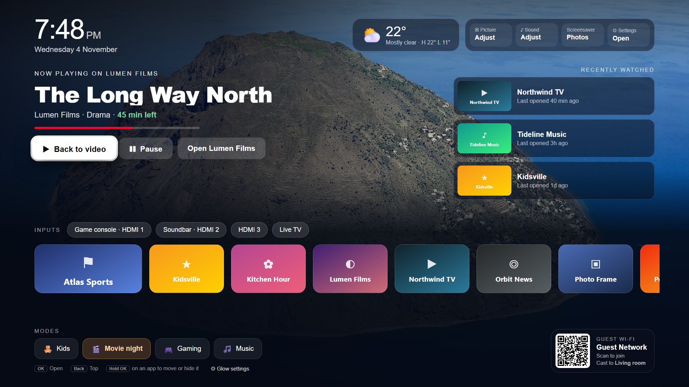
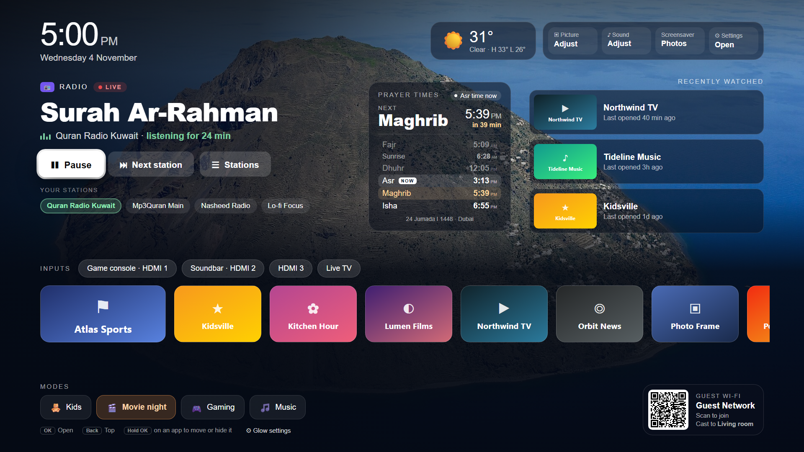
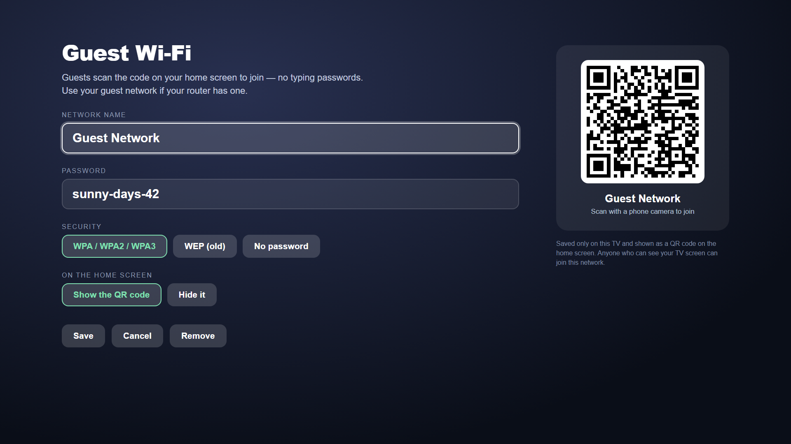
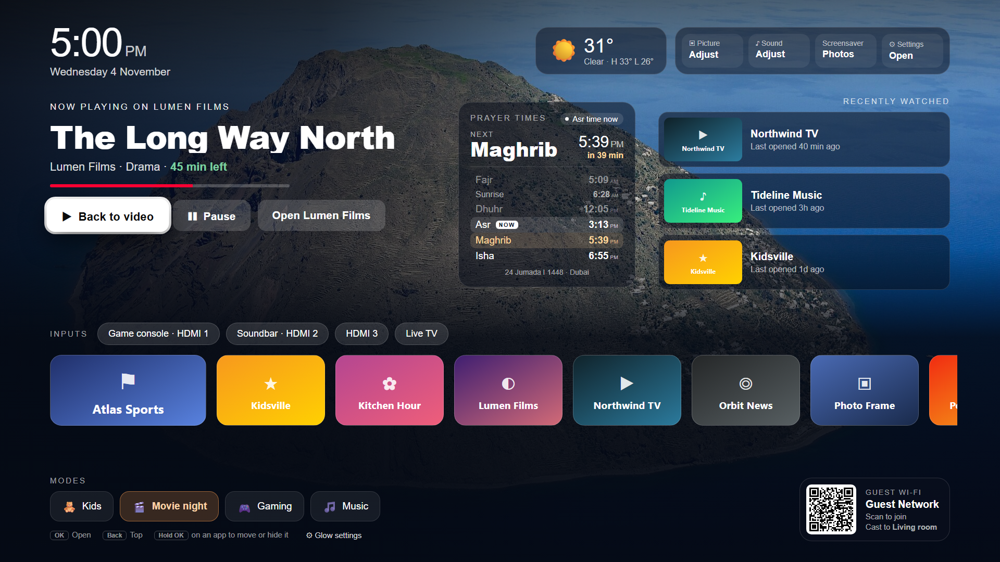
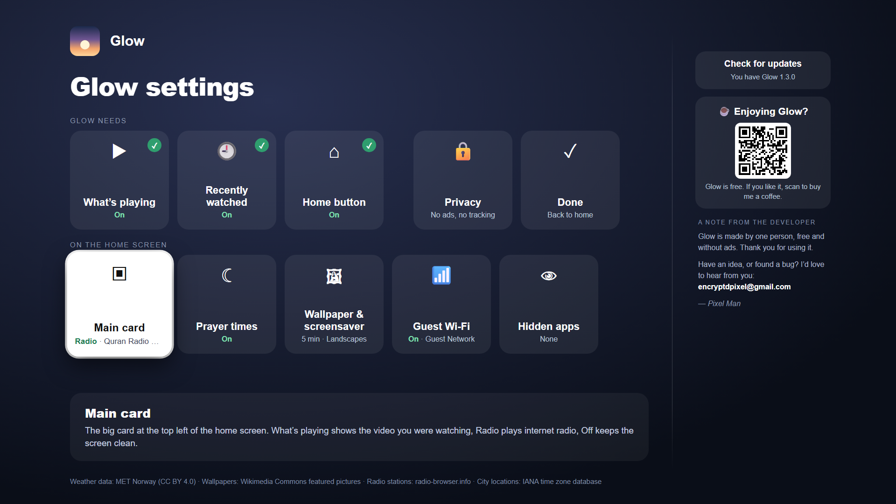
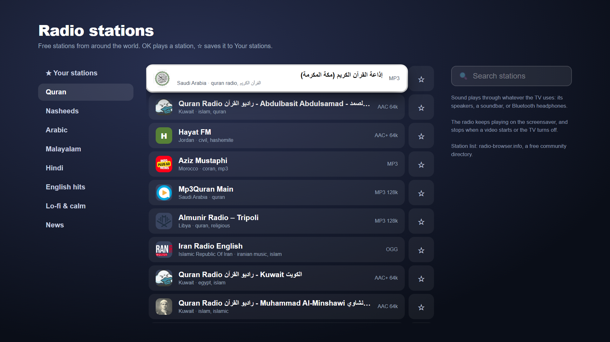

# Glow - A calm home screen for Android TV

Glow replaces your TV's busy home screen with a calm, simple one that puts what you watch first. No ads, no sponsored rows, no account.



- **Pick up where you left off:** the Resume banner shows what was playing last; one press of OK takes you back.
- **Radio (optional):** choose Radio as the main card to play internet radio on the home screen: Quran, nasheeds, news and music from stations around the world. It keeps playing on the screensaver, with the programme or song shown in the corner.
- **Your apps and inputs:** all your apps in one row, a "Recently watched" row, and your HDMI inputs one press away.
- **Modes:** Kids, Movie night, Gaming and Music bring the right apps to the front.
- **A new wallpaper every day:** featured landscape photos from Wikimedia Commons, plus a full-screen screensaver when the TV sits idle, each photo credited.
- **Weather and a big clock.**
- **Guest Wi-Fi in one scan (optional):** a QR code on the home screen that guests scan with their phone camera.
- **Prayer times (optional):** today's five prayers with a countdown to the next one and the Hijri date, calculated on the TV with your region's method. On by default in Muslim-majority regions; switch it on or off in Glow settings.

|  |  |
|---|---|



Works on Android TV and Google TV (Android 8 or newer), on TVs and on TV boxes such as the onn 4K, Chromecast with Google TV and Xiaomi Mi Box. TV boxes have no HDMI inputs of their own, so there the Inputs row is hidden.

## Download

**[Download the latest Glow APK](https://encryptdpixel.github.io/glow/glow.apk)** · [All releases](https://github.com/encryptdpixel/glow/releases)

## Install on your TV

The easiest way uses the free **Downloader** app, so you don't need a computer.

1. **Get Downloader.** On the TV, open Google Play, search for **Downloader** (by AFTVnews) and install it.
2. **Let Downloader install apps.** Go to **Settings › Apps › Security & restrictions › Unknown sources** and switch on **Downloader**.
   - On many Google TV models this menu only appears after you turn on developer options: go to **Settings › System › About**, select **Android TV OS build** seven times, then go back.
3. **Download Glow.** Open Downloader, select the address box and type:

   ```
   encryptdpixel.github.io/glow/apk
   ```

   Select **Go**. When the download finishes, select **Install**.
4. **If Play Protect warns you** that the app is from an unknown developer, select **More details › Install anyway**. Glow isn't on Google Play yet, so Play Protect doesn't know it.
5. **Open Glow** from your apps and follow its settings screen.

Prefer a computer? With adb: `adb install glow.apk`.

## Setting up

The first time, Glow settings walks you through three optional switches and explains each one before you turn it on:



- **Notification access**, to show what's playing on the Resume banner. Glow never reads or keeps your notifications.
- **Usage access**, for the "Recently watched" row.
- **An accessibility service**, so the remote's Home button opens Glow. Google TV normally sends Home to its own screen, and this is the only way to change that. Glow uses it only to catch the Home button and to notice when Google TV's home screen opens. It doesn't read the screen, see what you type or collect any data.

Some TV makers block the Home button for other home screens. On those TVs you can still open Glow from your apps.

Home button greyed out, "Restricted setting", or using a Fire TV? See **[Glow help](https://encryptdpixel.github.io/glow/help/)**.

## Arranging apps

Select an app and **hold OK** (or press Menu): **Move** it with ◀ ▶, move it to the front, or hide it. Each mode keeps its own order.

## Main card and Radio

In **⚙ Glow settings**, select **Main card** to choose what the big card at the top left shows: **What's playing** (the Resume banner), **Radio**, or **Off** for a cleaner screen.

With Radio, select **Stations** to browse by category (Quran, Nasheeds, Arabic, Malayalam, Hindi, English hits, Lo-fi, News) or search. OK plays a station, ☆ saves it to Your stations, which then appear on the card for one-press switching. The radio stops when a video starts, when you switch to an HDMI input, or when the TV turns off. Stations come from [radio-browser.info](https://www.radio-browser.info/), a free community directory; Glow only plays stations with secure (https) links.



## Screensaver

After a few idle minutes Glow fills the screen with photos, the time and the weather. In **⚙ Glow settings**, select **Wallpaper & screensaver** to choose the photos (landscapes, cities, nature, night sky, or your own from the TV or a USB drive), when it starts and how often the photo changes.

## Guest Wi-Fi

In **⚙ Glow settings**, select **Guest Wi-Fi** to enter your guest network. Guests scan the QR code on the home screen with their phone camera to join. Choose **Hide it** to keep the network saved but take the code off the home screen.

## Updating

Glow checks for new versions every few hours. When one is out, **⬆ Update to Glow x.y** appears at the top of the home screen: select it, then **Update now**. The first time, Android asks you to let Glow install apps. Your settings are kept. (Versions before 1.2.0 can't update themselves: repeat step 3 above once.)

## Privacy

Glow has no accounts, ads, analytics or tracking. What it knows about you stays on your TV. It only goes online for the weather (your city's location, not yours), the daily wallpaper, the radio stations you choose and the update check. Full policy: [encryptdpixel.github.io/glow-privacy](https://encryptdpixel.github.io/glow-privacy/).

## Support Glow

Glow is free. If it makes your TV nicer to use, you can [buy me a coffee through PayPal](https://paypal.me/encryptdpixel) ☕

## Credits

Weather data from [MET Norway](https://api.met.no/) (CC BY 4.0). Wallpapers from [Wikimedia Commons](https://commons.wikimedia.org/wiki/Commons:Featured_pictures) featured pictures, each credited on screen. City locations from the IANA time zone database. QR codes by qrcode-generator (MIT).

Questions or problems: [open an issue](https://github.com/encryptdpixel/glow/issues) or email encryptdpixel@gmail.com.
