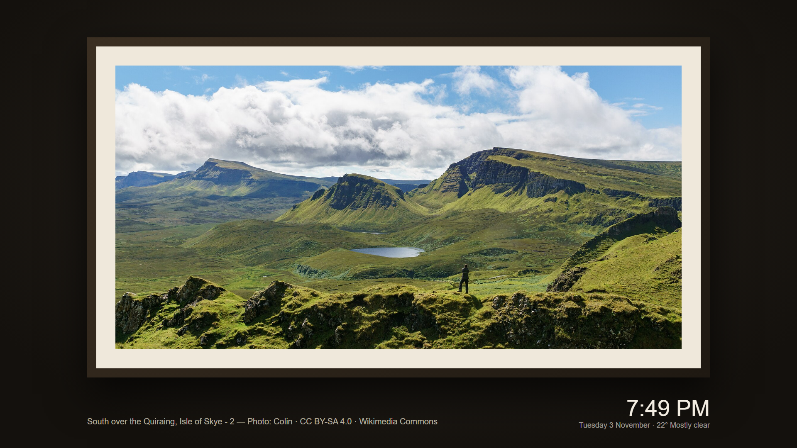

# Glow — a calm home screen for Android TV

Glow replaces your TV's busy home screen with a calm, simple one that puts what you watch first. No ads, no sponsored rows, no account.


- **Pick up where you left off:** the Resume banner shows what was playing last; one press of OK takes you back.
- **Your apps and inputs:** all your apps in one row, a "Recently watched" row, and your HDMI inputs one press away.
- **Modes:** Kids, Movie night, Gaming and Music bring the right apps to the front.
- **A new wallpaper every day:** featured landscape photos from Wikimedia Commons, each credited, plus an Art frame when the TV sits idle.
- **Weather and a big clock.**
- **Guest Wi-Fi in one scan:** a QR code on the home screen that guests scan with their phone camera.

|  |  |
|---|---|

Works on Android TV and Google TV (Android 8 or newer).

## Download

**[Download the latest Glow APK](https://github.com/encryptdpixel/glow/releases/latest/download/glow.apk)** · [All releases](https://github.com/encryptdpixel/glow/releases)

## Install on your TV

The easiest way uses the free **Downloader** app, so you don't need a computer.

1. **Get Downloader.** On the TV, open Google Play, search for **Downloader** (by AFTVnews) and install it.
2. **Let Downloader install apps.** Go to **Settings › Apps › Security & restrictions › Unknown sources** and switch on **Downloader**.
   - On many Google TV models this menu only appears after you turn on developer options: go to **Settings › System › About**, select **Android TV OS build** seven times, then go back.
3. **Download Glow.** Open Downloader, select the address box and type:

   ```
   encryptdpixel.github.io/glow/apk
   ```

   Select **Go**. When the download finishes, select **Install**.
4. **If Play Protect warns you** that the app is from an unknown developer, select **More details › Install anyway**. Glow isn't on Google Play yet, so Play Protect doesn't know it.
5. **Open Glow** from your apps and follow its setup screen.

Prefer a computer? With adb: `adb install glow.apk`.

## Setting up

Glow's setup screen walks you through three optional switches and explains each one before you turn it on:

- **Notification access**, to show what's playing on the Resume banner. Glow never reads or keeps your notifications.
- **Usage access**, for the "Recently watched" row.
- **An accessibility service**, so the remote's Home button opens Glow. Google TV normally sends Home to its own screen, and this is the only way to change that. Glow uses it only to catch the Home button and to notice when Google TV's home screen opens. It doesn't read the screen, see what you type or collect any data.

Some TV makers block the Home button for other home screens. On those TVs you can still open Glow from your apps.

## Updating

Glow checks for new versions once a day. When one is out, a **⬆ Glow x.y is out** link appears at the bottom of the home screen. To update, repeat step 3 above: Downloader installs the new version over the old one and keeps your settings.

## Privacy

Glow has no accounts, ads, analytics or tracking. What it knows about you stays on your TV. It only goes online for the weather (your city's location, not yours), the daily wallpaper and the daily update check. Full policy: [encryptdpixel.github.io/glow-privacy](https://encryptdpixel.github.io/glow-privacy/).

## Support Glow

Glow is free. If it makes your TV nicer to use, you can [buy me a coffee through PayPal](https://paypal.me/encryptdpixel) ☕

## Credits

Weather data from [MET Norway](https://api.met.no/) (CC BY 4.0). Wallpapers from [Wikimedia Commons](https://commons.wikimedia.org/wiki/Commons:Featured_pictures) featured pictures, each credited on screen. City locations from the IANA time zone database. QR codes by qrcode-generator (MIT).

Questions or problems: [open an issue](https://github.com/encryptdpixel/glow/issues) or email encryptdpixel@gmail.com.
